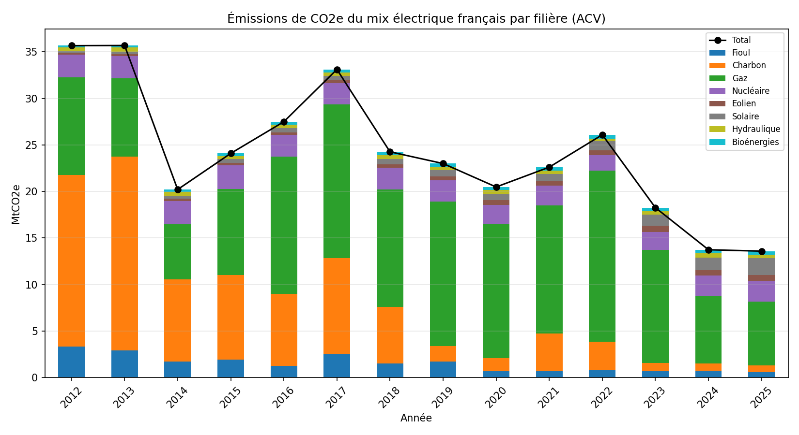
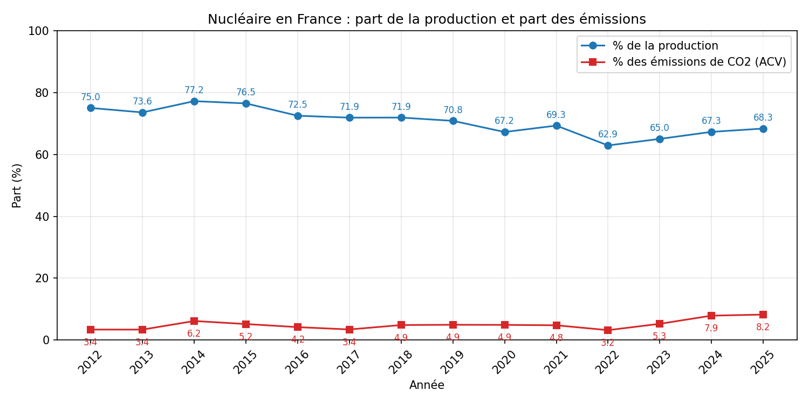
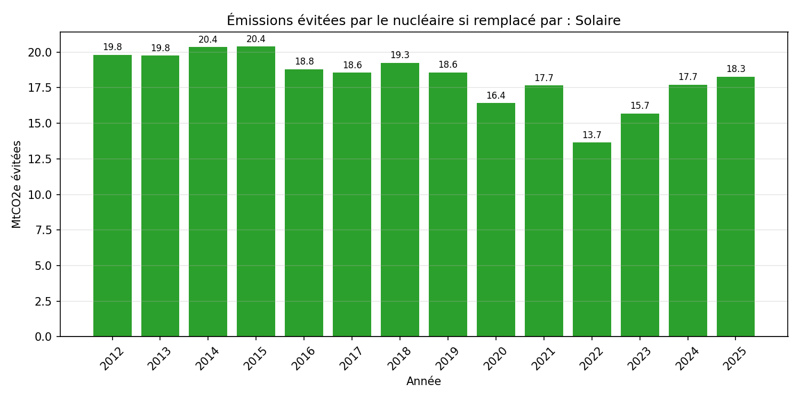
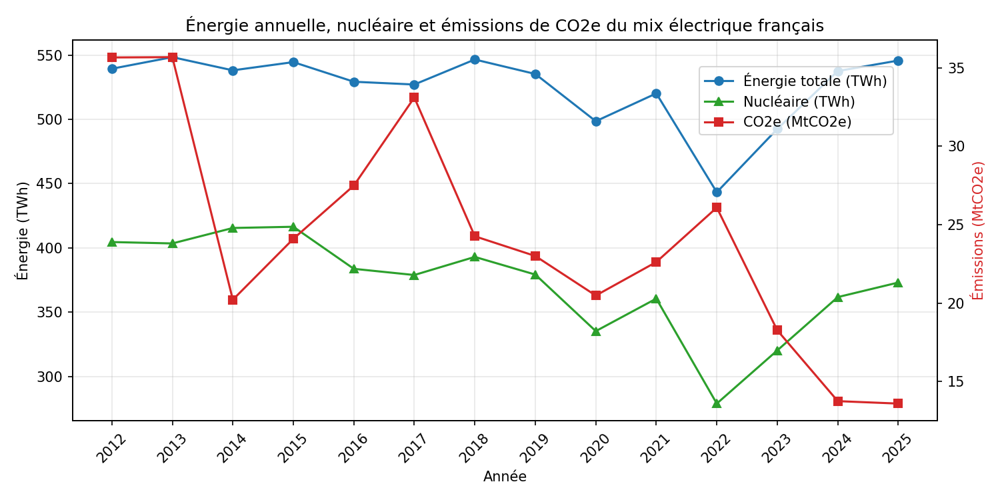

# ⚛️ Le nucléaire a-t-il un impact positif sur le bilan carbone de la France ?

Analyse des données de production électrique française (2012–2025) pour évaluer la contribution du nucléaire aux émissions de CO₂ du mix électrique, en analyse de cycle de vie (ACV).

## ❓ Question de recherche

> **Est-ce que le nucléaire a un impact positif, en termes d'impact carbone, en France ?**

Sous-questions :
1. Quelle part de la production électrique française vient du nucléaire ?
2. Quelle part des émissions de CO₂e du mix lui est attribuable ?
3. Quelles émissions supplémentaires si le nucléaire était remplacé par une autre filière (ici le solaire) ?

## 📊 Résultats

### 1. Émissions de CO₂e du mix par filière

Les émissions du mix passent de **35,7 MtCO₂e en 2012 à 13,6 MtCO₂e en 2025**.

Le gaz et le charbon dominent les émissions chaque année. En 2017, ils représentent environ 9 % de la production mais **81 %** des émissions (gaz 49,9 %, charbon 31,1 %). Le nucléaire, lui, représente 71,9 % de la production pour seulement **6,9 %** des émissions.

Le nucléaire a donc produit **7,7 fois plus d'énergie** que le gaz et le charbon réunis, tout en émettant **environ 91 fois moins de CO₂e pour chaque unité d'énergie produite**.

### 2. Part du nucléaire : production vs émissions

Le nucléaire fournit **63 % à 77 %** de l'électricité selon l'année, pour une part d'émissions bien plus faible (environ 6 % à 16 %). Cette part augmente sur la période parce que les émissions des autres filières baissent, pas parce que celles du nucléaire augmentent.

### 3. Émissions supplémentaires si le nucléaire était remplacé

À production égale, remplacer le nucléaire (6 g/kWh) par du solaire (55 g/kWh) ajouterait **14 à 20 MtCO₂e par an**. Ce scénario est volontairement simple : il ne tient compte ni de l'intermittence ni du stockage.

### 4. Énergie totale, nucléaire et émissions : l'évolution année par année

Ce graphique met côte à côte la production totale (TWh), la production nucléaire (TWh) et les émissions de CO₂e du mix (MtCO₂e). La production totale reste stable, autour de **500 à 550 TWh par an**, sauf en 2022 (environ 443 TWh). Les émissions chutent de **35,7 MtCO₂e en 2012 à 13,6 MtCO₂e en 2025**.

Le lien avec le nucléaire est visible lors des creux de production :
- **2017** : le nucléaire baisse à environ 379 TWh et les émissions montent à 33,1 MtCO₂e, car le gaz et le charbon compensent.
- **2022** : le nucléaire atteint son point bas, environ 279 TWh (crise de la corrosion sous contrainte et maintenances). Les émissions remontent à 26,1 MtCO₂e malgré une production totale plus faible.
- **2023 à 2025** : le nucléaire se redresse (environ 320, 361 puis 373 TWh) et les émissions s'effondrent jusqu'à 13,6 MtCO₂e.

Le nucléaire n'est pas le seul facteur. En 2012-2013, sa production est élevée (environ 404 TWh), mais les émissions sont les plus fortes de la période à cause du charbon. La baisse de 2014 s'explique par un recul du charbon, et la tendance après 2018 par la montée des renouvelables. En conclusion, **quand le nucléaire baisse, les émissions augmentent** parce que les énergies fossiles prennent le relais, mais d'autres filières jouent aussi.

## 🧪 Méthode

1. Données éCO2mix consolidées (RTE), 2012–2025. L'année 2026 est exclue car incomplète.
2. Suppression des lignes de 15 minutes vides, puis puissance moyenne annuelle par filière (MW).
3. Énergie annuelle : `kWh = MW × 1000 × heures` (8760 h, ou 8784 h en année bissextile).
4. Émissions : `énergie (kWh) × facteur ACV (g/kWh) / 10⁶ = tCO₂e`.
5. Intensité du mix (g/kWh) comparée au taux de CO₂ publié par RTE.

Facteurs ACV utilisés (g CO₂e/kWh) : fioul 730, charbon 1058, gaz 418, nucléaire 6, éolien 13, solaire 55, hydraulique 6, bioénergies 36.

## ⚠️ Limites

- Les échanges commerciaux et le pompage ne sont pas pris en compte (production uniquement).
- Les facteurs ACV sont uniques par filière (le gaz et les bioénergies regroupent plusieurs technologies).
- L'ACV du nucléaire varie de 4 à 6 g/kWh selon les sources. On retient 6.
- Le scénario de remplacement est théorique.
- Les aspects hors carbone (déchets, coût, sûreté, ressources) ne sont pas traités.
- Seul l'indicateur « changement climatique » de l'ACV est utilisé (g CO₂e/kWh). Les autres indicateurs d'impact (radiations ionisantes, épuisement des ressources, acidification, eutrophisation) ne sont pas analysés.
- Le coût, la sûreté et le débat sur la gestion des déchets à long terme ne sont pas traités.

## 🏁 Conclusion

Sur le seul critère du carbone, **le nucléaire a un impact positif** : il produit environ 70 % de l'électricité pour une part d'émissions bien inférieure. Il explique en grande partie le faible niveau du mix français. Cela ne dit rien de ses autres enjeux, non étudiés ici.

## 📚 Sources

- RTE, jeu de données **éCO2mix national (données consolidées)**, production d'énergie par filière en France.
- EDF, [Plaquette ACV du nucléaire (2022)](https://www.edf.fr/sites/groupe/files/2022-06/edfgroup_acv-4_plaquette_20220616.pdf) : ACV du nucléaire de 4 à 6 g/kWh.
- Ministère de la Transition écologique, [Données et calcul pour l'actualisation du facteur d'émission de l'électricité (RE2020)](https://rt-re-batiment.developpement-durable.gouv.fr/IMG/pdf/donnees_et_calcul_pour_l_actualisation_du_fe_de_l_electricite.pdf) : facteurs ACV par filière.
